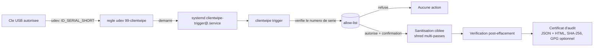

# ClientWipe

**Sanitisation automatisee et auditable de postes de pentest entre deux missions.**

## Le probleme

Entre deux missions d'audit/pentest, un consultant doit s'assurer qu'aucune
trace du client precedent (identifiants, projets Burp, configs VPN,
historique shell, documents recuperes) ne subsiste sur son poste avant la
mission suivante. En pratique, cette etape repose souvent sur la memoire et
la bonne volonte de chacun : pas de preuve, pas de tracabilite, et un vrai
risque de fuite de donnees entre clients (sujet directement couvert par
NIST SP 800-88 "Guidelines for Media Sanitization" et par l'esprit d'ISO
27001 sur la protection de l'information).

**ClientWipe** transforme cette etape manuelle en un geste simple et
verifiable : on branche une cle USB dediee, l'outil sanitise automatiquement
les emplacements sensibles connus, verifie qu'il ne reste rien, et produit un
certificat d'audit horodate.

## Architecture



## Fonctionnalites

- **Declenchement par cle USB** : une regle udev ne reagit qu'aux cles dont
  le numero de serie figure dans une allow-list ; le numero de serie est
  revalide cote Python (defense en profondeur). Pas d'autorun aveugle : une
  cle non enregistree ne declenche rien. Le service systemd tourne sans
  terminal, donc l'allow-list -- pas une confirmation humaine -- est
  l'autorisation reelle du declenchement automatique ; `clientwipe run`
  (usage manuel en ligne de commande) garde lui une confirmation
  interactive avant toute action destructive, et echoue proprement
  (sans crash) si elle est lancee sans terminal disponible.
- **Sanitisation ciblee** : effacement multi-passes (`shred` si disponible,
  sinon repli pur Python) des emplacements definis dans un fichier de
  configuration YAML (projets Burp, cles SSH, configs VPN, historique shell,
  profils navigateurs, telechargements/temp).
- **Verification independante** : un second passage re-scanne les mêmes
  cibles apres effacement pour detecter tout residu, au lieu de supposer que
  l'effacement a reussi.
- **Snapshot Timeshift automatique** : avant toute sanitisation reelle, le
  declenchement par cle USB (`trigger`) prend par defaut un snapshot
  Timeshift du systeme (`--skip-snapshot` pour desactiver) ; la commande
  manuelle `run` peut faire de meme avec `--snapshot`. Le resultat
  (reussite/echec/non disponible) est trace dans le certificat genere, pour
  toujours savoir si un point de restauration existait avant l'operation.
  Si Timeshift n'est pas installe, l'outil continue sans bloquer la
  sanitisation -- c'est un filet de securite, pas une dependance obligatoire.
- **Certificat d'audit** : rapport horodate (JSON + HTML) avec poste,
  operateur, methode, duree, resultat de verification et empreinte SHA-256 ;
  signature GPG optionnelle si une cle est disponible sur le poste.
- **Reset complet (mode avance, optionnel)** : wrapper autour de Clonezilla
  (`ocs-sr`) pour restaurer une image "golden" de reference plutot qu'une
  sanitisation ciblee.
- **Mode demo sans risque** : `clientwipe demo` cree un faux poste (fausses
  cles SSH, faux projet Burp, faux historique shell...) pour que tout le
  cycle soit testable en une commande, sans toucher a la moindre vraie
  donnee.

## Demarrage rapide (bac a sable de demo)

```bash
git clone <url-du-repo> clientwipe
cd clientwipe
pip install -e ".[dev]"

# Cree un faux poste de pentest avec des donnees factices
clientwipe demo --path demo/sandbox

# Sanitise, verifie, genere un certificat -- uniquement sur le bac a sable
clientwipe run --root demo/sandbox --config config/sanitize_targets.example.yaml

# Ouvrez le certificat genere dans certificates/certificate-*.html
```

Hors du bac a sable de demo, `clientwipe run` refuse de s'executer sans le
flag explicite `--yes` : c'est volontaire, pour qu'une execution accidentelle
sur de vraies donnees ne puisse pas passer inapercue.

## Test en conditions reelles (sur VM jetable)

Le declenchement par cle USB (udev/systemd) ne peut pas etre demontre par le
mode demo seul : il necessite un vrai noyau Linux avec un vrai gestionnaire
d'evenements udev. Pour le valider sans aucun risque :

1. **Creez une VM Linux jetable** (Kali ou Debian minimal) via
   VirtualBox/KVM/Proxmox, et prenez un snapshot juste apres l'installation
   de base. Deux options, a combiner si besoin :
   - un **snapshot hyperviseur** (VirtualBox/KVM/Proxmox) si disponible --
     le plus simple, restaure l'etat complet de la VM en un clic ;
   - **Timeshift**, installe dans la VM elle-meme
     (`sudo apt install timeshift`), pour un snapshot au niveau du systeme
     de fichiers (rsync ou BTRFS) -- utile si l'hyperviseur ne permet pas de
     snapshot facile, ou pour multiplier les points de restauration sans
     repasser par la console de l'hyperviseur :
     ```bash
     sudo timeshift --create --comments "avant test clientwipe"
     # ... test ...
     sudo timeshift --restore
     ```
2. Copiez ce depot sur la VM, puis installez-le :
   ```bash
   sudo ./install.sh
   ```
   Ce script installe le paquet, cree `/etc/clientwipe/`, copie la regle
   udev et le service systemd, et initialise une allow-list vide.
3. **Peuplez un faux profil utilisateur realiste** sur la VM pour simuler un
   vrai poste de pentest (reutilise le meme generateur que le mode demo) :
   ```bash
   python3 demo/seed_sandbox.py /home/pentest
   ```
4. **Enregistrez le numero de serie** de votre cle USB de test :
   ```bash
   udevadm info --query=property --name=/dev/sdX1 | grep ID_SERIAL_SHORT
   echo "<numero-de-serie>" | sudo tee -a /etc/clientwipe/allowed_usb_serials.txt
   ```
   Notez que ce snapshot (etape 1) sert a *vous*, le testeur, a rejouer le
   scenario plusieurs fois depuis un etat propre. Il est independant du
   snapshot Timeshift que l'outil prend *lui-meme* automatiquement avant
   chaque sanitisation declenchee par cle USB (voir "Fonctionnalites" ci-dessus) --
   les deux se completent : l'un protege vos essais, l'autre protege chaque
   execution reelle en production.
5. **Branchez la cle** et suivez le declenchement en direct :
   ```bash
   journalctl -u 'clientwipe-trigger@*' -f
   ```
   Vous devez voir le service demarrer, la confirmation demandee (ou
   l'execution directe si `--yes` a ete ajoute au service), puis la
   sanitisation, la verification et la generation du certificat dans
   `/var/log/clientwipe/certificates/`.
6. **Revenez au snapshot** (hyperviseur ou `sudo timeshift --restore`) avant
   de rejouer le test, pour repartir d'un etat propre a chaque essai.

Limite assumee : le mode `reset` (restauration d'image via Clonezilla) n'est
pas demontrable dans ce depot (il necessite une vraie infrastructure
d'imaging) -- il est donc uniquement couvert par des tests unitaires avec
`subprocess` simule, et documente comme mode avance a adapter en entreprise.

## Configuration

Les emplacements sanitises sont decrits dans un fichier YAML
(`config/sanitize_targets.example.yaml` fournit un point de depart) :

```yaml
passes: 3
targets:
  - name: ssh-keys
    patterns:
      - ".ssh/id_*"
      - ".ssh/known_hosts"
```

## Conformite

L'approche s'inspire de NIST SP 800-88 (plusieurs passes d'ecrasement avant
suppression, verification independante du resultat) et produit, a chaque
execution, une preuve exploitable en audit interne ou externe (ISO 27001,
exigences contractuelles client) : qui, quand, quoi, avec quel resultat.

## Limitations connues

- Le mode `reset` (Clonezilla) est un wrapper documente, non execute
  reellement dans ce depot (pas d'infrastructure d'imaging disponible en CI).
- La signature GPG du certificat est optionnelle et desactivee si aucune cle
  n'est configuree ou si `gpg` n'est pas installe.
- Le declenchement udev/systemd est specifique a Linux ; voir la section
  "Test en conditions reelles" pour le valider sur une VM jetable.

## Licence

MIT -- voir [LICENSE](LICENSE).
