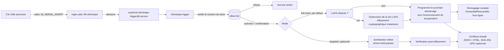

# ClientWipe

**Sanitisation automatisee et auditable de postes de pentest entre deux missions.**

## Le probleme

Entre deux missions d'audit/pentest, un consultant doit s'assurer qu'aucune
trace du client precedent (identifiants, projets Burp, configs VPN,
historique shell, documents recuperes) ne subsiste sur son poste avant la
mission suivante. En pratique, cette etape repose souvent sur la memoire et
la bonne volonte de chacun : pas de preuve, pas de tracabilite, et un vrai
risque de fuite de donnees entre clients (sujet directement couvert par
NIST SP 800-88 "Guidelines for Media Sanitization" et par l'esprit d'ISO
27001 sur la protection de l'information).

**ClientWipe** transforme cette etape manuelle en un geste simple et
verifiable : on branche une cle USB dediee et le poste repart integralement
a neuf, comme si un auditeur rallumait une machine jamais utilisee, tous
compartiments compris, pas seulement le profil utilisateur.

## Deux manieres de declencher ClientWipe

- **Cle autonome bootable** (`clientwipe live-wipe`, le modele vise pour la
  cle de production) : on redemarre le poste et on demarre directement sur
  la cle USB, comme une cle Clonezilla ou Kali live. Aucune installation
  prealable sur le poste cible n'est necessaire : la cle embarque tout
  (l'outil, l'image Kali de reference). C'est l'operateur qui choisit de
  booter sur cette cle precise qui constitue l'autorisation, donc pas de
  liste blanche de numero de serie ni de fenetre graphique a gerer, une
  simple confirmation tapee au clavier suffit.
- **Declenchement automatique pendant que le poste tourne** (`clientwipe
  trigger`, installe une fois via `install.sh`) : utile si on prefere que
  le nettoyage se declenche sans redemarrer manuellement sur une cle, des
  qu'une cle autorisee est branchee sur un poste deja equipe. Decrit en
  detail plus bas.

## Architecture



## Fonctionnalites

- **`clientwipe live-wipe` (cle autonome bootable)** : point d'entree pense
  pour tourner depuis un environnement demarre directement sur la cle USB
  (voir `clientwipe/live_wipe.py`). Reutilise exactement la meme logique de
  detection/destruction LUKS et de sauvegarde d'en-tete que le mode
  declenche automatiquement, mais reimage **immediatement** (pas besoin de
  programmer un redemarrage vers un environnement separe : l'environnement
  live demarre sur la cle *est* deja cet environnement de recuperation).
  Confirmation par simple saisie clavier (`OUI` en majuscules), pas de
  fenetre graphique necessaire puisqu'un operateur est forcement present au
  clavier pour avoir choisi de demarrer sur cette cle.
- **Remise a zero complete (mode par defaut du declenchement USB)** : au
  branchement de la cle, l'outil detecte automatiquement si le disque est
  chiffre en LUKS. Si oui, il detruit les cles de chiffrement : un
  effacement cryptographique NIST SP 800-88 niveau "Purge", instantane et
  fiable sur SSD/NVMe, contrairement a un simple multi-passes logiciel qui
  ne garantit rien face au wear-leveling. Il programme ensuite le
  redemarrage vers un environnement de recuperation dedie qui reimage le
  disque entier depuis une image de reference (voir `clientwipe/full_wipe.py`,
  `clientwipe/luks.py`). Resultat : tous les compartiments du poste sont
  couverts, pas seulement le profil utilisateur. Deploiement vise : la cle
  USB elle-meme embarque l'image Kali de reference (64 Go+ recommande) pour
  que l'environnement de recuperation puisse reimager sans dependance
  reseau. Si le disque n'est pas chiffre, l'etape de destruction de cle est
  simplement ignoree et l'outil passe directement au reimagage ; le niveau
  de garantie atteint ("Purge" ou "Clear") est trace explicitement dans le
  certificat genere, jamais suppose equivalent.
- **Sauvegarde de l'en-tete LUKS avant destruction (optionnelle, recommandee)** :
  Timeshift ne protege pas contre une destruction de cle LUKS : son
  snapshot est stocke *dans* le volume chiffre, donc perdu avec le reste.
  Si `header_backup_dir` est configure (typiquement un point de montage de
  la cle USB declencheuse elle-meme), l'outil sauvegarde l'en-tete LUKS
  (`cryptsetup luksHeaderBackup`) juste avant de detruire les cles : un vrai
  retour en arriere possible (`cryptsetup luksHeaderRestore` + l'ancienne
  phrase secrete) en cas de declenchement par erreur. Si l'emplacement
  configure n'est pas un point de montage actif au moment du declenchement
  (cle non branchee/montee), l'outil refuse de detruire la cle plutot que
  d'ecrire la sauvegarde au mauvais endroit.
- **Detection BitLocker (postes Windows)** : le poste cible n'a pas besoin
  d'etre Linux. Si le disque n'est pas chiffre en LUKS, l'outil verifie s'il
  s'agit d'un volume BitLocker (`cryptsetup bitlkDump`, support natif depuis
  cryptsetup 2.3, sans avoir besoin d'outils Windows) et le signale
  explicitement dans le certificat. Volontairement **detection seule, pas
  destruction** : contrairement a LUKS, il n'existe pas d'equivalent a
  `cryptsetup erase` pour le format BitLocker, et ecraser "a la main" les
  bons octets sans machine Windows BitLocker reelle pour valider serait une
  fausse garantie de niveau "Purge". Un poste Windows chiffre BitLocker est
  donc traite au niveau "Clear" (reimagage complet), pas "Purge". Voir
  `clientwipe/bitlocker.py`.
- **Multi-passes de secours sur le disque entier (uniquement si pas de LUKS)** :
  quand aucun LUKS n'est detecte (disque non chiffre, ou BitLocker que cet
  outil ne sait que detecter), le mode remise a zero complete et le mode cle
  autonome ecrasent en plus l'integralite du peripherique avec des donnees
  aleatoires (`shred`, ou repli pur Python si absent), configurable via
  `fallback_wipe_passes` (defaut 3). Le but : renforcer le niveau "Clear"
  dans ce cas degrade, en detruisant aussi les metadonnees de chiffrement
  eventuelles, pas seulement les donnees visibles. Si LUKS est present, cette
  etape est ignoree : la destruction de cle reste la seule methode utilisee,
  instantanee, pas besoin d'ecraser des heures de donnees pour un resultat
  cryptographiquement deja irreversible. Trace dans le certificat genere
  (`clientwipe/disk_wipe.py`).
- **Sanitisation ciblee (mode alternatif, `--mode targeted`)** : effacement
  multi-passes (`shred` si disponible, sinon repli pur Python) des
  emplacements definis dans un fichier de configuration YAML (projets Burp,
  cles SSH, configs VPN, historique shell, profils navigateurs,
  telechargements/temp), sans redemarrage. Plus rapide que le reset complet,
  mais n'offre pas la meme garantie d'exhaustivite. Les patterns sont
  relatifs a `--root` par defaut, mais un pattern commencant par `/` est
  resolu depuis la racine du systeme de fichiers (`/opt/pentest-tools/**`,
  un point de montage de loot...), et une **verification independante**
  re-scanne les memes cibles apres effacement pour detecter tout residu.
- **Declenchement par cle USB** : une regle udev ne reagit qu'aux cles dont
  le numero de serie figure dans une allow-list ; le numero de serie est
  revalide cote Python (defense en profondeur). Pas d'autorun aveugle : une
  cle non enregistree ne declenche rien. Le service systemd tourne sans
  terminal, donc clientwipe affiche a la place une fenetre
  "Autoriser"/"Refuser" sur la session de bureau active (via `zenity`,
  voir `clientwipe/gui_confirm.py`) avant toute action destructive. Si la
  fenetre expire sans reponse, ou si aucune session graphique n'est
  disponible, l'operation est refusee par defaut : jamais d'effacement
  silencieux sans qu'un humain ait pu dire non. `clientwipe run` (usage
  manuel en ligne de commande) garde de son cote une confirmation dans le
  terminal.
- **Snapshot Timeshift automatique** : avant toute operation reelle, le
  declenchement par cle USB (`trigger`) prend par defaut un snapshot
  Timeshift du systeme (`--skip-snapshot` pour desactiver) ; la commande
  manuelle `run` peut faire de meme avec `--snapshot`. Le resultat
  (reussite/echec/non disponible) est trace dans le certificat genere, pour
  toujours savoir si un point de restauration existait avant l'operation.
  Si Timeshift n'est pas installe, l'outil continue sans bloquer
  l'operation : c'est un filet de securite, pas une dependance obligatoire.
- **Certificat d'audit** : rapport horodate (JSON + HTML) avec poste,
  operateur, methode, duree/peripherique, resultat de verification et
  empreinte SHA-256 ; signature GPG optionnelle si une cle est disponible.
- **Mode demo sans risque** : `clientwipe demo` cree un faux poste (fausses
  cles SSH, faux projet Burp, faux historique shell...) pour que le cycle de
  sanitisation ciblee soit testable en une commande, sans toucher a la
  moindre vraie donnee.

## Demarrage rapide (bac a sable de demo)

```bash
git clone <url-du-repo> clientwipe
cd clientwipe
pip install -e ".[dev]"

# Cree un faux poste de pentest avec des donnees factices
clientwipe demo --path demo/sandbox

# Sanitise, verifie, genere un certificat (uniquement sur le bac a sable)
clientwipe run --root demo/sandbox --config config/sanitize_targets.example.yaml

# Ouvrez le certificat genere dans certificates/certificate-*.html
```

Hors du bac a sable de demo, `clientwipe run` refuse de s'executer sans le
flag explicite `--yes` : c'est volontaire, pour qu'une execution accidentelle
sur de vraies donnees ne puisse pas passer inapercue.

## Test en conditions reelles (sur VM jetable)

Le declenchement par cle USB (udev/systemd) ne peut pas etre demontre par le
mode demo seul : il necessite un vrai noyau Linux avec un vrai gestionnaire
d'evenements udev. Pour le valider sans aucun risque :

1. **Creez une VM Linux jetable** (Kali ou Debian minimal) via
   VirtualBox/KVM/Proxmox, et prenez un snapshot juste apres l'installation
   de base. Deux options, a combiner si besoin :
   - un **snapshot hyperviseur** (VirtualBox/KVM/Proxmox) si disponible :
     le plus simple, il restaure l'etat complet de la VM en un clic ;
   - **Timeshift**, installe dans la VM elle-meme
     (`sudo apt install timeshift`), pour un snapshot au niveau du systeme
     de fichiers (rsync ou BTRFS), utile si l'hyperviseur ne permet pas de
     snapshot facile, ou pour multiplier les points de restauration sans
     repasser par la console de l'hyperviseur :
     ```bash
     sudo timeshift --create --comments "avant test clientwipe"
     # ... test ...
     sudo timeshift --restore
     ```
2. Copiez ce depot sur la VM, puis installez-le :
   ```bash
   sudo ./install.sh
   ```
   Ce script installe le paquet, cree `/etc/clientwipe/`, copie la regle
   udev et le service systemd, et initialise une allow-list vide. Le
   service installe tourne en mode `full-reset` par defaut (voir
   "Limitations connues" : sa derniere etape, le reimagage, necessite un
   environnement de recuperation que ce depot ne fournit pas). Pour tester
   le mode `targeted` deja valide de bout en bout, editez
   `/etc/systemd/system/clientwipe-trigger@.service` et ajoutez a la fin de
   la commande `ExecStart` : `--mode targeted --root /home/<votre-utilisateur>`,
   puis `sudo systemctl daemon-reload`.
3. **Peuplez un faux profil utilisateur realiste** sur la VM pour simuler un
   vrai poste de pentest (reutilise le meme generateur que le mode demo) :
   ```bash
   python3 demo/seed_sandbox.py /home/<votre-utilisateur>
   ```
4. **Enregistrez le numero de serie** de votre cle USB de test :
   ```bash
   udevadm info --query=property --name=/dev/sdX1 | grep ID_SERIAL_SHORT
   echo "<numero-de-serie>" | sudo tee -a /etc/clientwipe/allowed_usb_serials.txt
   ```
   Notez que ce snapshot (etape 1) sert a *vous*, le testeur, a rejouer le
   scenario plusieurs fois depuis un etat propre. Il est independant du
   snapshot Timeshift que l'outil prend *lui-meme* automatiquement avant
   chaque sanitisation declenchee par cle USB (voir "Fonctionnalites" ci-dessus).
   Les deux se completent : l'un protege vos essais, l'autre protege chaque
   execution reelle en production.
5. **Branchez la cle** et suivez le declenchement en direct :
   ```bash
   journalctl -u 'clientwipe-trigger@*' -f
   ```
   Vous devez voir le service demarrer, puis une fenetre
   "Autoriser"/"Refuser" apparaitre sur le bureau de la VM (sauf si `--yes`
   a ete ajoute au service). Un clic sur "Autoriser" declenche la
   sanitisation, la verification et la generation du certificat dans
   `/var/log/clientwipe/certificates/`.
6. **Revenez au snapshot** (hyperviseur ou `sudo timeshift --restore`) avant
   de rejouer le test, pour repartir d'un etat propre a chaque essai.

Ce parcours valide le mode `--mode targeted` de bout en bout (udev, systemd,
fenetre graphique, effacement, verification, certificat). Le mode
`full-reset` (par defaut) ajoute deux etapes supplementaires non demontrables
de la meme facon :
- la destruction de cle LUKS (`clientwipe/luks.py`) est testable en reel des
  que le disque de la VM est chiffre (installeur Kali : "Assiste - utiliser
  tout un disque avec LVM chiffre") ;
- le reimagage complet lui-meme necessite un environnement de recuperation
  prepare a l'avance (entree GRUB dediee lancant Clonezilla/Rescuezilla sans
  interaction), une infrastructure hors du perimetre de ce depot, couverte
  uniquement par des tests unitaires avec `subprocess`/`grub-reboot` simules.

## Configuration

Un seul fichier YAML pilote les deux modes (`config/sanitize_targets.example.yaml`
fournit un point de depart) :

```yaml
# Mode full-reset (par defaut pour le declenchement USB)
full_reset:
  device: /dev/sda3
  boot_entry: "Clonezilla Recovery"
  header_backup_dir: /mnt/clientwipe-usb/luks-headers  # optionnel, voir Fonctionnalites
  fallback_wipe_passes: 3  # utilise uniquement si pas de LUKS detecte, voir Fonctionnalites

# Mode targeted (--mode targeted, ou clientwipe run)
passes: 3
targets:
  - name: ssh-keys
    patterns:
      - ".ssh/id_*"
      - ".ssh/known_hosts"
```

`clientwipe live-wipe` (cle autonome bootable) ne lit pas ce fichier : il
prend ses parametres directement en ligne de commande, puisqu'il est lance
manuellement depuis la console de l'environnement live, pas par un service
installe a l'avance :

```bash
clientwipe live-wipe \
  --device /dev/sda \
  --image golden-kali \
  --images-repository /mnt/usb-data \
  --header-backup-dir /mnt/usb-data/luks-headers
```

## Conformite

L'approche s'inspire de NIST SP 800-88 "Guidelines for Media Sanitization"
et d'ISO/IEC 27001 sur la protection de l'information :
- le mode `full-reset` (par defaut) vise le niveau "Purge" de NIST 800-88 :
  effacement cryptographique instantane (destruction de cle LUKS) suivi d'un
  reimagage complet, la methode recommandee sur SSD/NVMe la ou un simple
  multi-passes logiciel n'offre pas de garantie face au wear-leveling ;
- le mode `targeted` couvre le niveau "Clear" (multi-passes d'ecrasement,
  verification independante du resultat) ;
- un poste Windows chiffre BitLocker (detection seule, voir
  `clientwipe/bitlocker.py`) reste au niveau "Clear" : le certificat le
  precise explicitement plutot que de laisser croire a un niveau "Purge"
  non verifie.

Chaque execution produit une preuve exploitable en audit interne ou externe
(exigences contractuelles client, traçabilite qualite) : qui, quand, quoi,
avec quel resultat.

## Pourquoi pas de sauvegarde complete avant effacement

Deux approches ont ete evaluees pour le mode `full-reset` :
- **copier integralement le disque avant d'effacer**, pour pouvoir tout
  restaurer en cas d'erreur. Mais sur un poste physique (pas une VM avec
  snapshot hyperviseur instantane), copier un disque entier est une
  operation d'E/S lente (potentiellement des heures selon la taille et la
  vitesse du support), et la copie elle-meme, contenant toutes les donnees
  client, devient un nouvel actif sensible a proteger ;
- **un effacement rapide et definitif une fois confirme**, c'est le choix
  retenu. La protection contre une erreur se fait *avant* l'effacement (le
  numero de serie USB doit correspondre a l'allow-list, puis un humain doit
  cliquer "Autoriser" sur une fenetre explicite), pas apres coup.

La seule exception : la sauvegarde de l'en-tete LUKS (voir ci-dessus), qui
est rapide (quelques Ko) et protege une fenetre courte, le temps ou la cle a
ete detruite par erreur mais le disque n'a pas encore ete reimage. Une fois le
reimagage lance, cette sauvegarde, comme tout le reste, ne permet plus de
revenir en arriere : c'est assume.

**A BIEN COMPRENDRE** : la sauvegarde d'en-tete LUKS ne contient QUE la cle
de chiffrement (quelques Ko), JAMAIS les donnees du client. ClientWipe NE
CONSERVE AUCUNE COPIE DES DONNEES DU POSTE, nulle part, a aucun moment.
Avant reimagage, les donnees restent lisibles UNIQUEMENT si l'en-tete est
restaure avec l'ancien mot de passe (le disque physique n'a pas encore ete
touche). Des que le reimagage a eu lieu, les donnees d'origine sont
definitivement et irremediablement perdues : il n'existe aucun moyen, aucune
sauvegarde, pour les recuperer a ce stade.

## Limitations connues

- Le reimagage complet (etape finale du mode `full-reset`) suppose un
  environnement de recuperation prepare a l'avance sur le poste (entree
  GRUB dediee lancant Clonezilla/Rescuezilla sans interaction) : cette
  infrastructure est hors du perimetre de ce depot et n'est donc pas
  executee reellement ici, seulement couverte par des tests unitaires avec
  `subprocess`/`grub-reboot` simules. Voir "Test en conditions reelles".
- La destruction de cle LUKS, elle, est reelle et testable des que le
  disque cible est chiffre.
- La signature GPG du certificat est optionnelle et desactivee si aucune cle
  n'est configuree ou si `gpg` n'est pas installe.
- Le declenchement udev/systemd est specifique a Linux ; voir la section
  "Test en conditions reelles" pour le valider sur une VM jetable.
- `clientwipe live-wipe` est valide en conditions reelles sur une session
  Kali Live officielle (detection/sauvegarde/destruction LUKS reelles sur
  un vrai peripherique bloc, echec propre sans Clonezilla installe). Reste
  a construire : la cle definitive auto-suffisante (Kali **installe**
  dessus, pas juste Live, avec Clonezilla + image golden + demarrage
  automatique embarques), en pause suite a une instabilite materielle du
  passthrough USB rencontree pendant la construction, a reprendre en
  presentiel.
- La detection BitLocker (`clientwipe/bitlocker.py`) est testee
  unitairement (`cryptsetup bitlkDump` simule) mais pas encore validee sur
  un vrai volume BitLocker reel, faute de poste Windows chiffre disponible
  pour le test.

## Licence

MIT. Voir [LICENSE](LICENSE).
